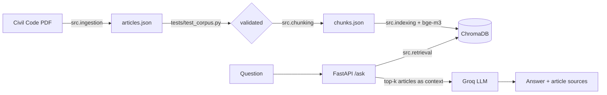

# Arabic Legal Q&A (RAG) over the Egyptian Civil Code

Ask a question in Arabic or English and get an answer grounded in the Egyptian Civil Code, with the
article numbers it is based on. If the retrieved articles do not cover the question, the system says so
instead of guessing.

ITI x MLOps - Project 2 (LLM / RAG).

## How it works



- **Corpus:** one record per article (`article_number`, Arabic and English text, book/chapter/section,
  `is_repealed`, `source_page`, `citation`). Repealed articles are flagged, never deleted.
- **Chunking:** by article, so every chunk keeps its article number and citation.
- **Embeddings:** `BAAI/bge-m3` on Arabic + English text, stored in ChromaDB.
- **Generation:** Groq LLM, prompted to answer only from the retrieved articles.
- **API:** FastAPI. `sources` are article citations, not chunk IDs.

## Quick start

You need Python 3.10-3.12, Docker, and a free Groq API key (https://console.groq.com).

The `dvc pull` remote is a private Google Drive folder, so a reviewer cannot pull from it. Everything is
rebuilt from the source PDF instead, which `dvc repro` does.

```bash
# 1. Get the code and the source PDF
git clone https://github.com/hebatoallah-yehya1111/legal-rag.git && cd legal-rag
# Download the PDF from <PDF_LINK> and save it as data/raw/egyptian_civil_code.pdf

# 2. Rebuild the corpus and the vector store from the PDF (about 25 minutes on CPU)
pip install -e ".[pipeline]" && dvc repro

# 3. Add your Groq key and start the API on http://localhost:8000
cp .env.example .env   # then put your key in .env as GROQ_API_KEY=...
docker compose up --build
```

Check it:

```bash
curl http://localhost:8000/health
# {"status":"healthy","documents_indexed":1148}
```

Then open http://localhost:8000/docs and try `POST /ask`. The first question is slower because the
embedding model loads on first use.

```json
{"question": "ما هو القانون الذي يحكم الالتزامات غير التعاقدية؟", "top_k": 5}
```

Response shape: `{"answer": "...", "sources": ["Egyptian Civil Code, Article 21", ...], "retrieved_articles": [...]}`.
An empty question returns `422`.

## Tests

```bash
pip install -e ".[dev]"
python -m pytest tests -q
```

The tests need no API key, no model and no index: the API and RAG tests use fakes, and the corpus tests
validate `data/processed/articles.json` (contiguous article numbers, non-empty Arabic text, no oversized
records, repealed articles flagged, no reversed lam-alef).

## Reproducibility

`dvc.yaml` defines four stages: `build_corpus` -> `validate_corpus` -> `build_chunks` -> `build_index`.
The validation stage stops the pipeline if the corpus tests fail, so a parsing bug cannot reach the
embeddings.

## Evaluation

Retrieval is measured without any LLM, on 29 in-scope questions whose correct article was found by
matching each question's reference quote against the corpus (`src/build_gold_articles.py`):

```bash
python -m src.build_gold_articles
python -m src.evaluate_retrieval
```

| Metric | Value |
|---|---|
| Hit@1 | 0.862 |
| Hit@3 | 0.931 |
| Hit@5 | 0.966 |
| Hit@10 | 1.000 |
| MRR | 0.904 |

Arabic (21 questions) and English (8 questions) are close: Hit@1 is 0.857 (18 of 21) vs 0.875 (7 of 8),
which is within noise at these sizes. These questions are written close to the article text, so they
are an easy case.
RAGAS (`src/ragas_evaluator.py`, Gemini as judge) was run on an earlier index and has to be re-run on the
current one before any faithfulness number is quoted.

<!-- TODO: add the MLflow comparison screenshot here (reports/mlflow_comparison.png) -->

## Problems found while building the corpus

- **Reversed lam-alef.** The PDF stores "لا" as one ligature glyph in logical order, while the rest of
  the word is in visual order. Reversing each word turned "لا يجوز" into "ال يجوز". Fixed by protecting
  ligature glyphs before the reversal.
- **Article 1022 has no Arabic text** in the source. It is kept with `ar_missing_in_source: true` (it is
  not repealed) and is skipped when indexing, since there is nothing to embed.
- **Typos in the English headers.** `Article1022` (no space) and `rticle 452` (missing letter) were not
  recognised as article starts, and some headers share a line with the first words of the article.
  Fixed with a more tolerant pattern that only accepts the next article number in sequence, so a wrapped
  cross-reference such as "Article 901 has been delivered" is not mistaken for a header.
- **Repealed articles** (54-80 and 389-417) are flagged `is_repealed: true`. Numbers the PDF does not
  print at all get a placeholder record, so "this article no longer exists" is a valid answer.
- **Known limitation:** unnumbered sub-headings (for example "Consideration:") stay attached to the end of
  the previous article's English text, and the `topic` metadata is wrong for many articles. Neither is
  used in the embedding text; `topic` would matter if it were used as a retrieval filter.

## Limitations

- `sources` lists the retrieved articles, not only the ones the answer actually relies on, so it can
  include articles the answer rejects.
- Abstract questions that depend on many articles (for example "what are the conditions for a valid
  contract?") are answered with "cannot determine", because the retrieved articles do not cover them.
- Only one of the 30 evaluation questions is out of scope, which is too few to measure refusal behaviour.

## Not done yet

GitHub Actions CI, serving with BentoML and streaming, load testing, Langfuse tracing, and the
optimization work.

## Project layout

```
src/        ingestion, chunking, indexing, retrieval, rag, api, evaluation scripts
tests/      corpus, API, RAG and retrieval-metric tests
data/       raw PDF (DVC), processed corpus and vector store (DVC), evaluation sets
dvc.yaml    corpus -> validate -> chunks -> index pipeline
Dockerfile  CPU image with the embedding model and the vector store baked in
```