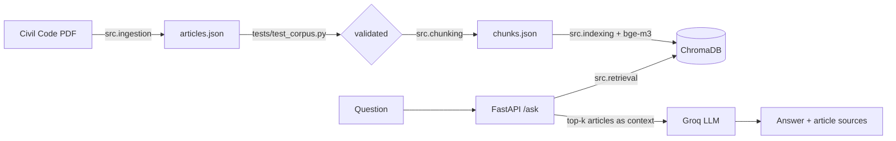

# Arabic Legal Q&A (RAG) over the Egyptian Civil Code

Ask a question in Arabic or English and get an answer grounded in the Egyptian Civil Code, with the
article numbers it is based on. If the retrieved articles do not cover the question, the system says so
instead of guessing.

MLOps - Project 2 (LLM / RAG).

## How it works



- **Corpus:** one record per article (`article_number`, Arabic and English text, book/chapter/section,
  `is_repealed`, `source_page`, `citation`). Repealed articles are flagged, never deleted.
- **Chunking:** by article, so every chunk keeps its article number and citation.
- **Embeddings:** `BAAI/bge-m3` on Arabic + English text, stored in ChromaDB.
- **Generation:** Groq LLM, prompted to answer only from the retrieved articles.
- **API:** FastAPI. `sources` are article citations, not chunk IDs. Both normal and SSE streaming endpoints are available.
- **Tracing:** optional Langfuse instrumentation for `/ask` and `/ask/stream` when credentials are configured.

## Quick start

You need Python 3.10-3.12, Docker, and a free Groq API key (https://console.groq.com).

The DVC remote is a private Google Drive folder, so a reviewer cannot run `dvc pull`. It is not needed:
the source PDF is committed in `data/raw`, and `dvc repro` rebuilds the corpus and the vector store from it.

```bash
# 1. Get the code (the source PDF is already in data/raw)
git clone https://github.com/hebatoallah-yehya1111/legal-rag.git && cd legal-rag

# 2. Rebuild the corpus and the vector store from the PDF (about 25 minutes on CPU)
pip install -e ".[pipeline]" && dvc repro

# 3. Add your Groq key and start the API on http://localhost:8000
cp .env.example .env   # Windows PowerShell: copy .env.example .env
# then put your key in .env as GROQ_API_KEY=...
docker compose up --build
```

Check it:

```bash
curl http://localhost:8000/health
# {"status":"healthy","documents_indexed":1148}
```

Then open http://localhost:8000/docs and try `POST /ask`. The first question is slower because the
embedding model loads on first use. `POST /ask/stream` streams answer tokens as Server-Sent Events.

```json
{"question": "ما هو القانون الذي يحكم الالتزامات غير التعاقدية؟", "top_k": 5}
```

Response shape: `{"answer": "...", "sources": ["Egyptian Civil Code, Article 21", ...], "retrieved_articles": [...]}`.
An empty question returns `422`.

## Tests

```bash
pip install -e ".[dev]"
python -m pytest tests -q
```

The tests need no API key, no model and no index: the API and RAG tests use fakes, and the corpus tests
validate `data/processed/articles.json` (contiguous article numbers, non-empty Arabic text, no oversized
records, repealed articles flagged, no reversed lam-alef).

## Reproducibility

`dvc.yaml` defines four stages: `build_corpus` -> `validate_corpus` -> `build_chunks` -> `build_index`.
The validation stage stops the pipeline if the corpus tests fail, so a parsing bug cannot reach the
embeddings.

## Evaluation

Retrieval is measured without any LLM, on 29 in-scope questions whose correct article was found by
matching each question's reference quote against the corpus (`src/build_gold_articles.py`):

```bash
python -m src.build_gold_articles
python -m src.evaluate_retrieval
```

| Metric | Value |
|---|---|
| Hit@1 | 0.862 |
| Hit@3 | 0.931 |
| Hit@5 | 0.966 |
| Hit@10 | 1.000 |
| MRR | 0.904 |

Arabic (21 questions) and English (8 questions) are close: Hit@1 is 0.857 (18 of 21) vs 0.875 (7 of 8),
which is within noise at these sizes. These questions are written close to the article text, so they
are an easy case.
The evaluation set in `data/evaluation/evaluation_dataset.json` has 50 unique questions (49 in-scope, one
out-of-scope). The saved RAGAS report (`data/evaluation/ragas_scores.json`, judge: Groq `openai/gpt-oss-120b`)
scored 49 questions:

| RAGAS metric | Value |
|---|---|
| faithfulness | 0.697 |
| answer_relevancy | 0.666 |
| context_precision | 0.895 |
| context_recall | 0.939 |

Faithfulness is **below** the 0.75 CI gate and the 0.80 alert level, so the quality gate currently fails.
Context precision and recall are high, so retrieval is not the main problem: the low scores come from the
generated answers (claims the judge cannot match to the retrieved text). To re-run:

```bash
python -m src.Genrating_RAG_answers
pip install -e ".[evaluation]"
# Set GROQ_API_KEY in .env (default RAGAS_PROVIDER=auto prefers Groq), then:
python -m src.ragas_evaluator
# Or set RAGAS_PROVIDER=gemini and GEMINI_API_KEY to use Gemini as the judge.
```

Optional request tracing can be enabled with `pip install -e ".[observability]"` and valid
`LANGFUSE_PUBLIC_KEY`, `LANGFUSE_SECRET_KEY`, and `LANGFUSE_HOST` values. Load tests are defined in
`load_tests/locustfile.py`; install `pip install -e ".[load-test]"` and run
`locust -f load_tests/locustfile.py --host http://localhost:8000`. No load-test report is checked in yet.

<!-- TODO: add the MLflow comparison screenshot here (reports/mlflow_comparison.png) -->

## Problems found while building the corpus

- **Reversed lam-alef.** The PDF stores "لا" as one ligature glyph in logical order, while the rest of
  the word is in visual order. Reversing each word turned "لا يجوز" into "ال يجوز". Fixed by protecting
  ligature glyphs before the reversal.
- **Article 1022 has no Arabic text** in the source. It is kept with `ar_missing_in_source: true` (it is
  not repealed) and is skipped when indexing, since there is nothing to embed.
- **Typos in the English headers.** `Article1022` (no space) and `rticle 452` (missing letter) were not
  recognised as article starts, and some headers share a line with the first words of the article.
  Fixed with a more tolerant pattern that only accepts the next article number in sequence, so a wrapped
  cross-reference such as "Article 901 has been delivered" is not mistaken for a header.
- **Repealed articles** (54-80 and 389-417) are flagged `is_repealed: true`. Numbers the PDF does not
  print at all get a placeholder record, so "this article no longer exists" is a valid answer.
- **Known limitation:** unnumbered sub-headings (for example "Consideration:") stay attached to the end of
  the previous article's English text, and the `topic` metadata is wrong for many articles. Neither is
  used in the embedding text; `topic` would matter if it were used as a retrieval filter.

## Limitations

- `sources` lists the retrieved articles, not only the ones the answer actually relies on, so it can
  include articles the answer rejects.
- Abstract questions that depend on many articles (for example "what are the conditions for a valid
  contract?") are answered with "cannot determine", because the retrieved articles do not cover them.
- Only one of the 50 evaluation questions is out of scope, which is too few to measure refusal behaviour.

## Experiment tracking (MLflow)

```bash
mlflow server --backend-store-uri sqlite:///mlflow.db --default-artifact-root ./mlartifacts --port 5000
python -m src.chunking_experiments --register-best
```

This logs 5 chunking settings (`chunk_size`, `overlap`, `embedding_model`) with Hit@k, MRR and chunk count,
and registers the best one as `legal-rag-chunking-config`. The comparison measures retrieval, not RAGAS
faithfulness, because a faithfulness run per setting needs hundreds of LLM calls; the RAGAS runs are logged
separately with `python -m src.log_ragas_to_mlflow`.

<!-- TODO: add the MLflow comparison screenshot here (reports/mlflow_comparison.png) -->

## Quality gate and alert

```bash
python -m src.quality_gate --fail-below 0.75 --alert-below 0.80
```

Exit code 1 fails CI (faithfulness below 0.75). Exit code 2 means "passed, but below 0.80", and sends a message
to the webhook in `ALERT_WEBHOOK_URL` (Slack or Discord style). CI runs this on every push and weekly.
It reads the saved RAGAS report; it does not call the LLM itself.

## Adding new documents without a full rebuild

```bash
python -m src.add_documents --input data/new/new_articles.json
```

Chunks, embeds and upserts only the given articles. Running it twice does not duplicate chunks
(`tests/test_add_documents.py`).

## Tracing (Langfuse, self-hosted)

```bash
git clone https://github.com/langfuse/langfuse.git && cd langfuse && docker compose up -d
```

Open http://localhost:3000, create a project, copy the keys into `.env`, then:

```bash
pip install -e ".[observability]"
python -m src.ragas_to_langfuse   # one trace per evaluated question, with its faithfulness score
```

Every call to `/ask` and `/ask/stream` also creates a trace once the keys are set.

## Serving, load test, canary

- `src/bento_service.py`: BentoML service with async `ask` and streaming `ask_stream`
  (`bentoml serve src.bento_service:LegalRAGService`).
- LLM: Groq hosted API. There is no local vLLM server because this project runs without a GPU.
- Load test: `locust -f load_tests/locustfile.py --host http://localhost:8000 --headless -u 50 -r 5 -t 3m --html reports/locust_report.html`.
  The hosted LLM rate-limits, so 429 responses are reported as their own failure type.
- Canary: `deploy/nginx-canary.conf` sends 5% of traffic to the new image and 95% to the stable one.
  Rollout stages: 5% for one day, then 25%, 50%, 100%, rolling back to 0% if faithfulness drops below 0.75.

## Remaining work

- Raise RAGAS faithfulness above 0.75 (currently 0.697) and re-run the evaluation.
- Take the MLflow, Langfuse and Locust screenshots/reports and add them under `reports/`.
- Run the full pipeline once in CI and confirm the image is pushed to GHCR.

## Project layout

```
src/        ingestion, chunking, indexing, retrieval, rag, api, evaluation scripts
tests/      corpus, API, RAG and retrieval-metric tests
data/       raw PDF (DVC), processed corpus and vector store (DVC), evaluation sets
dvc.yaml    corpus -> validate -> chunks -> index pipeline
Dockerfile  CPU image with the embedding model and the vector store baked in
```

### Constraints and Resource Limitations

**Use of Groq's Free API Tier:** The project relies on Groq's free API tier to access a hosted Large Language Model (LLM). Although this made it possible to implement and test the generation component without paying for a commercial API, the free tier is subject to rate limits and usage quotas. These restrictions can limit the number and frequency of requests, particularly during repeated evaluations, load testing, and experiments requiring many LLM calls. As a result, some experiments may take longer or require multiple runs, and high-concurrency testing may produce rate-limit errors such as HTTP 429 responses. These constraints should be considered when interpreting the project's evaluation and performance results.

**Limited Lab Resources:** The project was developed within a lab environment with limited computational resources, particularly in terms of GPU availability and processing capacity. Consequently, running and serving a large open-source language model locally was not a practical option within the available infrastructure. Instead, the project uses Groq's hosted inference service for text generation, while the retrieval component relies on embeddings and a vector database. This was a practical engineering decision based on the available resources rather than a claim that locally hosted open-source models are inherently unsuitable.

**Impact on Evaluation and Future Improvements:** These limitations affect the scale and repeatability of experiments, especially comprehensive LLM evaluation, large-scale load testing, and comparisons between different generation models. Future work could address these constraints by obtaining access to stronger hardware, using an appropriately funded inference service, or evaluating smaller models that can run within the available hardware budget. Until then, the project's results should be interpreted in the context of the API quotas and computational resources available during development.